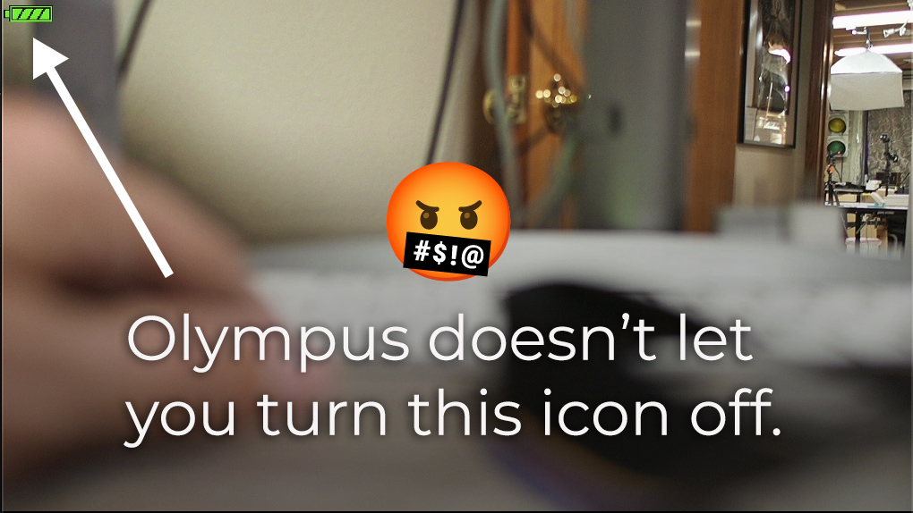

# Olympus E-M10 Mark III: hide the full-battery icon

Getting a clean HDMI feed from the Olympus OM-D E-M10 Mark III is frustrating: a persistent battery icon is added to the video, with no built-in option we found to turn it off. The latest official firmware listed by OM SYSTEM is version 1.2, released on [March 7, 2019](https://support.jp.omsystem.com/en/support/imsg/digicamera/download/software/firm/e1/). After this long, I am not counting on an official fix.



Luckily, AI-assisted reverse engineering made it possible to investigate the firmware and fix this on my camera. That is what this project is: an unofficial improvement with one purpose—remove the full-battery icon from the HDMI feed. You do not need AI, programming knowledge, or command-line tools to install it.

A few caveats before you try it:

- **The full-battery icon also disappears from the camera screen.** That is the compromise: this modification affects both displays, rather than HDMI alone.
- **Only the full-battery image is made transparent.** The partial/low-battery images are unchanged, so they are expected to appear as the battery runs down, but I have not yet confirmed that on hardware. I accepted this compromise because I use this camera as a webcam with external power, where it reports a full battery.
- **You could brick your camera.** The edit is small—changing the full-battery image’s pixels to be transparent—but installing it still writes firmware, and the risk has not been quantified. There is no proven emergency recovery method. You have to trust the supplied file and accept the risk yourself. It is provided without warranty; I accept no responsibility for damage or other problems caused by installing it.
- **There is probably a more elegant solution.** If you want to improve this, I encourage you to investigate further, with or without AI. An HDMI-only fix that keeps the full-battery icon on the camera screen would be a useful next step.

The fix was successfully tested on one **Olympus OM-D E-M10 Mark III running body firmware 1.2**: the camera worked and the full-battery icon disappeared from both HDMI and the camera screen.

**Use only with the E-M10 Mark III, with body firmware 1.2.** Do not use it on the original E-M10, Mark II, Mark III S, Mark IV, or another camera. Check the model printed on your camera and the body firmware version in its menu before continuing. Other starting firmware versions have not been tested.

## What you need

- Your E-M10 Mark III with body firmware 1.2.
- A fully charged, healthy camera battery.
- An SD card already formatted by this camera, preferably a spare.
- A computer and an SD card reader.

Back up any photos on the card first. These instructions do not require formatting the card or deleting photos. Keep the camera powered reliably throughout installation.

## 1. Download

On this repository's main GitHub page, choose **Code → Download ZIP**. Extract the downloaded ZIP file. Do not copy the ZIP itself to the SD card.

Inside the extracted folder, you should see this README, an `images` folder used by this page, and a folder called `DCOLYMP` containing `E1309999.BIN`.

## 2. Copy to the SD card

1. Turn the camera off and remove its SD card.
2. Connect the card to your computer using a card reader.
3. Open the card in Finder (Mac) or File Explorer (Windows).
4. Copy the downloaded `DCOLYMP` folder directly onto the card, alongside any existing `DCIM` folder. Do not put it inside `DCIM` or inside another folder.
5. If `DCOLYMP` already exists, open it and copy only `E1309999.BIN` into it. If it already contains a firmware update file, stop and identify that file before continuing. Do not leave multiple update files in the folder.
6. Check that `E1309999.BIN` is inside `DCOLYMP` on the card. Keep both names exactly as supplied.
7. Safely eject the card from your computer.

The result should look like this:

```text
SD card
├── DCIM                 (your existing photo folder, if present)
└── DCOLYMP
    └── E1309999.BIN
```

## 3. Install

1. Make sure the camera is **off**, with its fully charged battery installed. Disconnect HDMI and USB cables.
2. Insert the prepared SD card.
3. Hold the camera's **OK** button while switching the camera on, then release OK after startup.
4. The screen may stay black. The front lamp should light steadily while the update runs. **Do not switch off, remove the battery, or remove the card during this stage.**
5. Wait for the front lamp to change to **rapid blinking**, the completion signal observed during our successful test. Do not use a fixed waiting time as proof that the update is finished.
6. After that completion signal, turn the camera off and remove the SD card.

This is a community SD-card update method, not the official USB updater procedure. If the lamp behavior differs or completion is unclear, stop following the steps and seek help before changing the power state. Do not assume a black screen or elapsed time means it is safe to interrupt an update.

## 4. Remove the update file

**Do this before starting the camera normally with this card.**

1. Reconnect the SD card to your computer.
2. Open `DCOLYMP` on the card.
3. Delete **only `E1309999.BIN`** from that folder. Leave your photos and other files alone. The empty `DCOLYMP` folder can stay.
4. On a Mac, empty the Trash while the card is still connected if the deleted file was moved there. Check that `E1309999.BIN` is no longer in `DCOLYMP`.
5. Safely eject the card and return it to the camera.

## 5. Done

Start the camera normally. Reconnect HDMI if you use it. With a full battery, the battery icon should be absent from **both HDMI and the camera screen**. The body firmware version remains **1.2**.

## What this changes—and what has been tested

Only the full-battery graphic is made transparent. It disappears on the camera screen as well as HDMI; this is not an HDMI-only switch.

The partial/low-battery graphics and battery monitoring code are unchanged. However, the appearance of low-battery warnings after this modification has **not yet been tested on hardware**. Check them during ordinary battery use before relying on them. Other display modes have not been exhaustively tested.

This firmware does **not** remove the video recording time limit or extend any HDMI runtime limit. Long-duration HDMI streaming has not yet been tested. No other feature unlocks are included.

The successful hardware test confirmed normal camera operation and removal of the full-battery icon from HDMI and the camera screen. It does not establish reliability across every camera or usage mode.

## Removing the modification

Deleting the update file from the SD card does **not** undo the installed modification. Restoring the original graphic would require installing unmodified stock firmware. A tested stock-restoration procedure is not included here, and stock firmware is not a guaranteed rescue for a failed update.

## File information

For anyone who wants to verify the download, the supplied firmware is:

- File: `DCOLYMP/E1309999.BIN`
- Size: **91,445,280 bytes**
- SHA-256: `156efe5d824c5fcac1083455a1de0b042d3b537596c3d0d41e6cf90203d49511`

It is based on official E-M10 Mark III body firmware 1.2. The modification changes only the color values in one full-battery image, preserving its original image layout, and updates the containing component's checksum. Offline checks confirmed valid component checksums, exact decode/re-encode reconstruction, and unchanged unrelated firmware data.

This project is independent of Olympus and OM SYSTEM. The original camera firmware remains the property of its respective rights holders; this repository does not grant rights to that underlying firmware.
